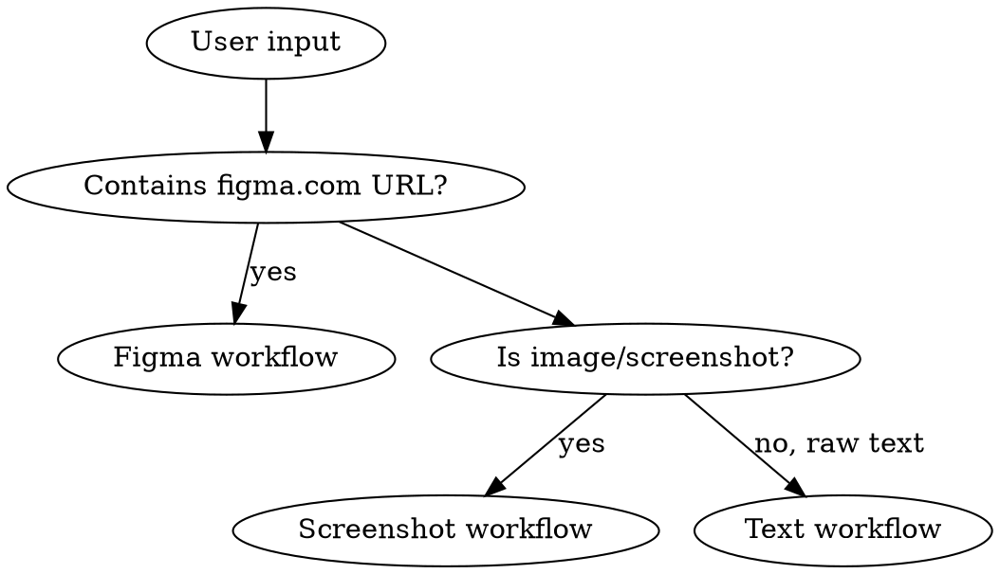
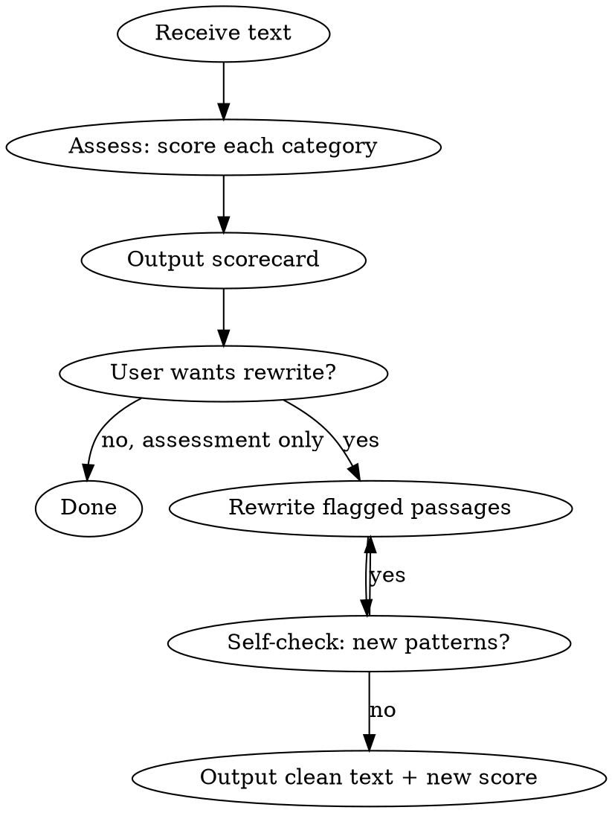

# Reference 04 — Vercel writing, accessible UX text and human editorial review

Read ALL parts for any interface messages, labels, forms, Arabic/English marketing text or site documentation.


---

# Vercel writing handbook (MIT)
**Upstream:** https://github.com/vercel-labs/writing-guidelines/blob/main/command.md

---
description: Review docs/prose for Vercel Writing Guidelines compliance
argument-hint: <file-or-pattern>
---

# Writing Guidelines

Review these files for compliance: $ARGUMENTS

Read files, check against rules below. Output concise but comprehensive: sacrifice grammar for brevity. High signal-to-noise.

## Rules

### Planning & content type

- Every page has a plan (overview, goal, audience, content plan, open questions) referenced or linked
- Content type declared in `meta.contentType`: `Tutorial`, `How-to`, `Reference`, `Conceptual`, `Troubleshooting`, or `Landing`
- Title is user-shaped (the user's question), not feature-shaped (the engineer's name)
- Page does one job: tutorial OR how-to OR reference, not three at once
- Goal is verb-driven (Bloom's taxonomy): "configure", "explain", "debug" (testable)
- Multi-audience pages: short shared opener, then technical subsections

### Voice & tone

- Active voice. Mental test: append "by monkeys". If the sentence parses, rewrite
- Direct address: `you`, never `the user` or `one can`
- Imperative for steps: "Click **Add Project**", not "You will need to click **Add Project**"
- Sentences under 20 words target
- Contractions encouraged (`you'll`, `it's`) for warmth
- Present tense unless describing future behavior
- Limit `we`: only for deliberate Vercel actions ("we recommend", "we deprecated"), never as a stand-in for "you"
- No rhetorical questions (sounds like marketing)
- Second-read test: read each sentence once at speech pace; if you re-read to parse it, name the subject, the action, and the consequence (kill metaphor verbs and pronouns reaching back several sentences)

### Banned words

- `easy`, `simple`, `quick`: puts pressure on the reader and reads as marketing; replace with concrete description ("one command", "default settings", "most projects don't need this")
- `very`, `just`, `really`: filler; cut or rewrite

### Concision

- Earn every detail: cut a number, name, or implementation detail if a more general phrasing wouldn't change the reader's understanding or action
- Weasel words: replace vague qualifiers (`significantly`, `many`, `often`, `typically`, `generally`) with a specific number or claim
- Vague quantifiers: no `near-zero`, `sub-second`, `most requests`; give the figure and cite it (`99.37% of requests see zero cold starts`)
- Filler/metaphor verbs: name the action instead of reaching for cadence (`moves through`, `lands`, `carries`, `hits` → the literal step)

### AI-generated tells (flag these)

- Summary-style transitions: never open a paragraph by recapping the last one (`With this setup complete…`, `Now that we've explored…`); pivot straight to the next point (`In practice…`, `The catch is…`)
- Stop-start sentences: don't split one dependent idea into choppy fragments (`Previously this was manual. Now it's automatic. This saves time.` → one sentence); short sentences for emphasis are fine
- Spec-sheet voice: rewrite sentences that read like a system reading a datasheet (`provides`, `is configurable`, `is explicitly labeled`)
- Cold-open paragraphs: a body paragraph whose first sentence works as a standalone heading has no antecedent; carry the prior subject forward (`Because…`, `Once…`)
- Personified artifacts: machines don't perform human-physical actions (`hand the browser a URL` → `the browser fetches the URL`; `the token holds…` → `the token is stored…`)
- Reused framing: the angle must come from this page, not a template (`The question most teams face is whether…`)

### Tone, by content type

- **Tutorial**: warm, encouraging, predictable structure, no traps
- **How-to**: terse, direct (reader is mid-task)
- **Reference**: neutral, exhaustive, quotable
- **Conceptual**: explain like the reader will teach it back; examples and analogies welcome
- **Troubleshooting**: empathetic but not apologetic; acknowledge then fix

### Headings

- Sentence case for page headings (`H1` `H2` `H3`): "Configure environment variables", not "Configure Environment Variables"
- Title case for nav labels: "Configuring Environment Variables"
- `meta.title` becomes the `H1`; `meta.navLabel` becomes the sidebar entry
- Subheadings descriptive, not cute: "Caveats when self-hosting on Cloudflare", not "Caveats"
- Reader should be able to guess section content from the heading alone

### Structure

- Every page opens with a one-paragraph TL;DR of what the page covers
- Every major section opens with a summary sentence
- Acronyms spelled out on first use: "Content Security Policy (CSP) blocks inline scripts"
- Define every term the first time you use it (link to its conceptual page)
- Reference docs organized by surface; education docs organized by reader task
- Keep paragraphs to 2 to 4 sentences; split anything longer or covering two ideas

### Lists

- Three or more list-shaped items in a paragraph: convert to a list
- Bulleted for unordered; numbered for ordered (lifecycles, sequential steps)
- Always introduce a list with a colon
- No periods at the end of list items unless they are full sentences
- Bold/description format: `- **Term**: description here` (colon after bold term)

### Code

- Code blocks need a language tag for syntax highlighting
- TypeScript is the default for new code unless the surface is genuinely language-agnostic
- Multi-step flows wrapped in `<Steps/>` so structure is visible
- Highlight load-bearing lines: `` ```typescript {8-12,23-37} ``
- ≤80 columns per line in snippets
- ≤25 lines per snippet; split longer blocks with prose
- Omit defaults; don't repeat variable definitions, use shared var
- Minimal comments in code blocks; prefer prose explanation
- Explain what every code block does in prose (don't drop and run)
- Don't reference full example files at the end of guides ("See `train.py`"); the guide is the deliverable

### Placeholders

- Text placeholders: `snake_case`, descriptive: `your_access_token_here` (so reader can double-click to select before pasting)
- Number placeholders: count up `1234567890123` (recognizable as fake, predictable)
- Never `<TOKEN>`, `xxx`, `your-token`, or generic ALL_CAPS

### Data sizes & units

- Space + uppercase unit: `64 KB`, `5 KB`, `200 ms`
- Exception: seconds is bare: `30s`
- Consistent across the corpus so readers can develop scanning habits

### Money & pricing pages

- Uncompromising detail: err on "too much"
- Use tables for pricing
- Never assume reader knows the pricing model or whether their workload counts as one invocation or several
- Clarity and transparency above all else

### Emphasis

- **Bold** means UI element or critical fact, never emphasis-for-emphasis-sake
- Reaching for bold for tone: the sentence is weak; rewrite it
- `Inline code` for paths, file extensions, identifiers, short snippets: `/api`, `.tsx`, `body`, `query`, `req`
- Rule: if it would look weird without a monospace font, monospace it

### Punctuation & typography

- Never em dashes (`—`) or dashes (`-`) as punctuation; use colons, commas, periods, or rephrase
- Curly quotes `"` `"` and `'` `'`, not straight `"` or `'`
- Ellipsis `…`, not three dots `...`
- Loading states end with `…`: `Loading…`, `Saving…`
- Non-breaking spaces in `10&nbsp;MB`, `⌘&nbsp;K`, brand names
- `&` over "and" only where space-constrained (nav labels, buttons)

### Source formatting

- Don't hard-wrap paragraphs: each paragraph is one line in source, let the editor wrap
- One blank line before headings; one blank line before and after code blocks
- No `---` horizontal rules between sections
- No extra blank lines between elements that aren't paragraph breaks

### Links

- Define every term the first time it appears, link to its conceptual page
- Anchor text names the destination; never bare URLs or `here`/`link`
- Dashboard deep links use the standard format: `https://vercel.com/d?to=%2F%5Bteam%5D%2F~%2Fai-gateway%2Fapi-keys&title=AI+Gateway+API+Keys`
- Link to canonical product docs where relevant: `https://vercel.com/docs/vercel-sandbox`, `https://vercel.com/docs/ai-gateway`
- AI Gateway model catalog: `https://vercel.com/ai-gateway/models`

### Models in examples

- Always use the latest model strings: `anthropic/claude-opus-4-7`, not `anthropic/claude-sonnet-4` or older
- For image generation default: `google/gemini-3.1-flash-image-preview`

### AI workflow

- You are accountable for the content you produce, however it is created
- You are the final arbiter; the model proposes, you dispose
- Hold technical accuracy to a high standard: docs are also consumed by LLMs, wrong docs train wrong models
- Use only enterprise models that do not train on your data (especially for unreleased products)
- Disclose AI use in the PR (model + prompts if useful)
- Plan first by hand; the plan is the spec the model works against
- Use plan-mode in your editor (Cursor, Claude) before letting the model write
- Tell the model to follow `AGENTS.md` and the linting checklist
- Run a test prompt against the preview: "given this plan's goal, can the model complete the task using only this page?"
- Final human review always

### Quality checklist (required boxes are non-negotiable)

- **Findability**: sidebar bucket set via `meta.category`; UI links to docs from any dashboard surface that exposes the feature
- **Accuracy**: code samples actually run; screenshots map 1:1 to current UI and use the ACME demo account
- **Relevance**: code samples included where applicable (TypeScript first; `<Steps/>` for multi-step flows)
- **Clarity**: overview addresses who/what/where/why; high-level use cases laid out; quickstart for new products; prerequisites listed on tutorials; sample repo in `vercel/examples` for multi-step tutorials; steps detailed not vague; visual aids in confusing sections; simplest path recommended when multiple exist
- **Completeness**: limits documented; all-limits tables updated; content plan followed and goals addressed
- **Readability**: nav names scannable and use action verbs; content types accurately used; subheadings descriptive; topics start with summaries; code blocks formatted correctly; active voice where warranted

### Review

- PR description links to the content plan, lists what to review, and links the preview URL
- Ping the team via the PR link (not the plan or preview directly)
- Author is accountable, not the reviewer; reviewers are liberal with approvals
- Suggestion comments for small text fixes; preview comments for anything bigger
- Disagreement is fine; reject with a one-line reason and move on

### Anti-patterns (flag these)

- Em dashes (`—`) or dashes (`-`) used as punctuation
- `easy`, `simple`, `quick` describing reader actions
- Passive voice (apply "by monkeys" test)
- Title Case in page headings (only sentence case in `H1` through `H6`)
- Generic placeholders: `<TOKEN>`, `xxx`, `your-token`, `ABC123`
- Code blocks without a language tag
- JS examples where TypeScript is the convention
- Code blocks over 25 lines without prose between
- Hard-wrapped prose paragraphs (multiple lines for one paragraph in source)
- `---` horizontal rules between sections
- Subheadings that are single generic words: `Overview`, `Caveats`, `Notes`
- Bold used for emphasis instead of UI element or critical fact
- Page or section without an opening summary
- Straight quotes (`"`, `'`) instead of curly (`"`, `'`)
- Three dots (`...`) instead of ellipsis (`…`)
- Acronyms used before being spelled out
- Bare unit numbers (`64KB`, `5kb`, `200MS`) instead of `64 KB`, `5 KB`, `200 ms`
- "We" standing in for "you"
- Rhetorical questions
- Filler words: `very`, `just`, `really`, `simply`
- References to "the full example file at the end of the guide" rather than inlining the code
- Outdated model strings in examples (`anthropic/claude-sonnet-4`, `gpt-4o`, DALL-E)
- Hardcoded date/number formats instead of `Intl.DateTimeFormat` / `Intl.NumberFormat` in code samples
- "Loading..." instead of "Loading…"
- Summary-style transitions recapping the previous paragraph (`With this setup complete…`)
- Stop-start fragments splitting one dependent idea into choppy sentences
- Spec-sheet voice reading like a datasheet (`provides`, `is configurable`, `is explicitly labeled`)
- Cold-open body paragraphs whose first sentence has no antecedent
- Personified artifacts performing human-physical actions (`hand the browser a URL`)
- Reused/template framing not specific to the page (`The question most teams face is whether…`)
- Weasel words instead of a specific claim (`significantly`, `many`, `often`, `typically`, `generally`)
- Vague quantifiers without a cited figure (`near-zero`, `sub-second`, `most requests`)
- Filler/metaphor verbs instead of the literal step (`moves through`, `lands`, `carries`, `hits`)
- Sentences that need a second read to parse
- Paragraphs over 4 sentences or covering two ideas
- Bare URLs or `here`/`link` as anchor text

## Output Format

Group by file. Use `file:line` format (VS Code clickable). Terse findings.

```text
## content/docs/sandbox.mdx

content/docs/sandbox.mdx:1 - missing meta.contentType
content/docs/sandbox.mdx:12 - title "Vercel Sandbox" is feature-shaped, not user-question
content/docs/sandbox.mdx:24 - passive voice ("the sandbox is created...")
content/docs/sandbox.mdx:31 - banned word "easy"
content/docs/sandbox.mdx:47 - "..." → "…"
content/docs/sandbox.mdx:58 - code block missing language tag
content/docs/sandbox.mdx:71 - placeholder <TOKEN> → your_access_token_here
content/docs/sandbox.mdx:89 - "64KB" → "64 KB"
content/docs/sandbox.mdx:102 - H2 "Caveats" too generic; add specificity
content/docs/sandbox.mdx:118 - em dash in prose, replace with colon/comma

## content/docs/ai-gateway.mdx

content/docs/ai-gateway.mdx:5 - title case in H1; sentence case only
content/docs/ai-gateway.mdx:18 - acronym AI Gateway used before being spelled out
content/docs/ai-gateway.mdx:34 - bold for emphasis, not UI element
content/docs/ai-gateway.mdx:52 - `anthropic/claude-sonnet-4` outdated; use `anthropic/claude-opus-4-7`
content/docs/ai-gateway.mdx:71 - hard-wrapped paragraph (lines 71-74)

## content/docs/cron.mdx

✓ pass
```

State issue + location. Skip explanation unless fix is non-obvious. No preamble.


---

# Full UX-writing skill (MIT)
**Upstream:** https://github.com/content-designer/ux-writing-skill/blob/main/SKILL.md

---
name: ux-writing
description: Create user-centered, accessible interface copy (microcopy) for digital products including buttons, labels, error messages, notifications, forms, onboarding, empty states, success messages, and help text. Use when writing or editing any text that appears in apps, websites, or software interfaces, designing conversational flows, establishing voice and tone guidelines, auditing product content for consistency and usability, reviewing UI strings, or improving existing interface copy. Applies UX writing best practices based on four quality standards — purposeful, concise, conversational, and clear. Includes accessibility guidelines, research-backed benchmarks (sentence length, comprehension rates, reading levels), expanded error patterns, tone adaptation frameworks, and comprehensive reference materials.
---

# UX Writing

Write clear, concise, user-centered interface copy (UX text/microcopy) for digital products and experiences. This skill provides frameworks, patterns, and best practices for creating text that helps users accomplish their goals.

**Compatible with:** Claude, Codex, Cursor, and other agents that support the agent skills specification.

**Note:** This skill works with Codex CLI/IDE, not ChatGPT. ChatGPT cannot install or use skills.

## When to Use This Skill

Use this skill when:
- Writing interface copy (buttons, labels, titles, messages, forms)
- Editing existing UX text for clarity and effectiveness
- Creating error messages, notifications, or success messages
- Designing conversational flows or onboarding experiences
- Establishing voice and tone for a product
- Auditing product content for consistency and usability

## Core UX Writing Principles

### The Four Quality Standards

Every piece of UX text should be:

1. **Purposeful** — Helps users or the business achieve goals
2. **Concise** — Uses the fewest words possible without losing meaning
3. **Conversational** — Sounds natural and human, not robotic
4. **Clear** — Unambiguous, accurate, and easy to understand

### Key Best Practices

**Conciseness**
- Use 40-60 characters per line maximum
- Every word must have a job
- Break dense text into scannable chunks
- Front-load important information

**Clarity**
- Use plain language (7th grade reading level for general, 10th for professional)
- Avoid jargon, idioms, and technical terms
- Use consistent terminology throughout
- Choose meaningful, specific verbs

**Conversational Tone**
- Write how you speak
- Use active voice 85% of the time
- Include prepositions and articles
- Avoid robotic phrasing

**User-Centered**
- Focus on user benefits, not features
- Anticipate and answer user questions
- Use second-person ("you") language
- Match user's language and mental models

## UX Text Patterns

Apply these common patterns for interface elements.

### Titles
- **Purpose**: Orient users to where they are
- **Format**: Noun phrases, sentence case
- **Types**: Brand titles, content titles, category titles, task titles
- **Examples**: "Account settings", "Your library", "Create new post"

### Buttons and Links
- **Purpose**: Enable users to take action
- **Format**: Active imperative verbs, sentence case
- **Pattern**: `[Verb] [object]` 
- **Examples**: "Save changes", "Delete account", "View details"
- **Avoid**: Generic labels like "OK", "Submit", "Click here"

### Error Messages
- **Purpose**: Explain problem and provide solution
- **Format**: Empathetic, clear, actionable
- **Pattern**: `[What failed]. [Why/context]. [What to do].`

**Error Message Types**

**Validation Errors (Inline)**
- Show as user completes field or on blur
- Brief, specific guidance to correct input
- Pattern: `[Field] [specific requirement]`
- Examples:
  - "Email must include @"
  - "Password must be at least 8 characters"
  - "Choose a date in the future"
- Timing: Real-time or on field exit
- Location: Below or beside the field

**System Errors (Modal/Banner)**
- Show when backend operations fail
- Explain what happened and why
- Pattern: `[Action failed]. [Likely cause]. [Recovery step].`
- Examples:
  - "Payment failed. Your card was declined. Try a different payment method."
  - "Couldn't save changes. Connection lost. Reconnect and try again."
  - "Upload failed. File is too large. Choose a file under 10MB."
- Timing: Immediately after failure
- Location: Modal dialog or prominent banner

**Blocking Errors (Full-screen)**
- Prevent continued use until resolved
- Clear explanation of blocker and resolution
- Pattern: `[What's blocked]. [Why]. [Specific action needed].`
- Examples:
  - "Update required. This version is no longer supported. Update now to continue."
  - "Subscription expired. Your account is paused. Renew subscription to restore access."
  - "Verification needed. Confirm your email to access features. Check your inbox."
- Timing: On app launch or feature access
- Location: Full screen or large modal

**Permission Errors**
- Explain benefit before requesting permission
- Pattern: `[User benefit]. [Permission needed].`
- Examples:
  - "Get notified when orders ship. Enable notifications."
  - "Find nearby stores. Allow location access."
  - "Back up your photos. Grant storage permission."
- Timing: When feature is first used
- Location: In context of the feature

**What to Avoid**
- Technical codes without explanation ("Error 403")
- Blame language ("invalid input", "illegal character")
- Robotic tone ("An error has occurred")
- Dead ends (error with no recovery path)
- Vague causes ("Something went wrong")

### Success Messages
- **Purpose**: Confirm action completion
- **Format**: Past tense, specific, encouraging
- **Pattern**: `[Action] [result/benefit]`
- **Examples**: "Changes saved", "Email sent", "Profile updated"

### Empty States
- **Purpose**: Guide users when content is absent
- **Types**: First-use, user-cleared, error/no results
- **Format**: Explanation + CTA to populate
- **Example**: "No messages yet. Start a conversation to connect with your team."

### Form Fields
- **Labels**: Clear noun phrases describing input ("Email address", "Phone number")
- **Instructions**: Verb-first, explain why information is needed
- **Placeholder**: Use sparingly, only for standard inputs like "name@example.com"
- **Helper text**: Static, on-demand, or automatic based on importance

### Notifications
- **Purpose**: Deliver timely, valuable information
- **Types**: Action-required (intrusive), Passive (less intrusive)
- **Format**: Verb-first title + contextual description
- **Example**: "Update required. Install the latest version to continue."

## Voice and Tone

### Voice (Consistent Brand Personality)
Voice is the consistent personality of the product. Establish voice using:
- **Concepts**: 3-5 key brand principles/values
- **Voice characteristics**: Descriptive adjectives for each concept
- **Do/Don't examples**: Concrete examples showing voice in action

See references/voice-chart-template.md for creating a voice chart.

### Tone (Adaptive to Context)
Tone is how voice adapts to specific situations. While voice remains constant, tone shifts based on user context and emotional state.

**Tone Variables**
- **Purpose**: Why user is seeing this text (information, action, confirmation)
- **Context**: What user is trying to do (learning, completing task, recovering from error)
- **Emotional state**: How user likely feels (frustrated, excited, confused, cautious)
- **Stakes**: Impact of the action (low: changing theme, high: deleting account)

**Tone Adaptation by User Emotional State**

**Frustrated** (errors, failures, blockers)
- Empathetic and solution-focused
- Acknowledge the problem without blame
- Provide clear recovery path
- Example: "Payment failed. Your card was declined. Try a different payment method."

**Confused** (first use, complex features)
- Patient and explanatory
- Break down steps clearly
- Provide context and guidance
- Example: "Connect your bank to see spending insights. We'll guide you through it."

**Confident** (routine tasks, return visits)
- Efficient and direct
- Minimal explanation
- Quick confirmation
- Example: "Saved"

**Cautious** (high-stakes actions, data loss)
- Serious and transparent
- Clear consequences
- Respectful of user's decision
- Example: "Delete account? You'll lose all data and this can't be undone."

**Successful** (completions, achievements)
- Positive and encouraging
- Proportional to achievement
- Brief celebration
- Example: "Profile updated. Your changes are live."

**Tone Adaptation by Content Type**

**Error messages**: Empathetic, reassuring, solution-focused
- Never blame user
- Explain what happened
- Provide clear next step

**Success messages**: Positive, specific, encouraging
- Confirm what happened
- Proportional to action importance
- Brief and clear

**Instructions**: Clear, direct, helpful
- Front-load key action
- Explain why when needed
- Use simple steps

**Onboarding**: Inviting, encouraging, concise
- Welcome without overwhelming
- Focus on value
- Celebrate early wins

**Confirmations**: Serious, transparent, respectful
- Clear about consequences
- No manipulation
- Easy to back out

**Empty states**: Hopeful, actionable, guiding
- Explain why it's empty
- Provide clear next action
- Keep encouraging tone

## Editing Process

Edit UX text in four phases:

### Phase 1: Purposeful
- Does text help user achieve their goal?
- Does text serve business objectives?
- Is value to user clear?
- Are concerns anticipated and addressed?

### Phase 2: Concise
- Remove unnecessary words
- Combine redundant information
- Ensure every word earns its space
- Front-load important concepts

### Phase 3: Conversational
- Read aloud—would you say this?
- Use active voice (unless passive is clearer)
- Include natural connecting words
- Avoid corporate jargon

### Phase 4: Clear
- Use specific, accurate verbs
- Maintain consistent terminology
- Test readability (Hemingway Editor, Flesch-Kincaid)
- Ensure unambiguous meaning

## Workflow

1. **Understand context**
   - User goals and needs
   - Business objectives
   - Technical constraints
   - Emotional state of user

2. **Draft content**
   - Start with conversation (what would you say?)
   - Apply appropriate pattern
   - Consider voice and tone
   - Front-load important information

3. **Edit iteratively**
   - Phase 1: Purposeful
   - Phase 2: Concise
   - Phase 3: Conversational
   - Phase 4: Clear

4. **Test and measure**
   - Review with team
   - Test with users when possible
   - Measure task completion, comprehension
   - Iterate based on feedback

## Accessibility in UX Writing

Writing accessible content ensures all users, including those using assistive technology, can understand and interact with your product.

### Core Accessibility Principles

**Screen Reader Optimization**
- Label all interactive elements explicitly ("Submit form" not just "Submit")
- Write descriptive link text ("Read pricing details" not "Click here")
- Structure error messages to work with screen readers (error + field label read together)
- Use ARIA labels when visual context isn't sufficient

**Cognitive Accessibility**
- Target 8-14 words per sentence (8 words = 100% comprehension, 14 words = 90%)
- Break complex information into scannable chunks
- Use clear headings and logical hierarchy
- Provide consistent, predictable patterns

**Multi-Modal Communication**
- Don't rely on color alone to convey meaning
- Pair visual indicators with text ("Error: Email required" with red icon)
- Provide text alternatives for icons and images
- Ensure sufficient color contrast (WCAG AA minimum: 4.5:1)

**Plain Language for All**
- Target 7th-8th grade reading level for general audience
- Define technical terms when first used
- Avoid idioms, metaphors, and cultural references
- Use common, everyday words

### Accessible Pattern Examples

**Buttons**
- ❌ Poor: "Submit" (context missing for screen readers)
- ✅ Good: "Submit application"

**Links**
- ❌ Poor: "Click here for more information"
- ✅ Good: "Read our privacy policy"

**Error Messages**
- ❌ Poor: Red text showing "Invalid"
- ✅ Good: "Error: Email must include @" (with error icon)

**Form Labels**
- ❌ Poor: Placeholder-only fields
- ✅ Good: Visible label + optional placeholder

## UX Text Benchmarks

Use these research-backed metrics to create effective UX text.

### Sentence Length Targets

**By Content Type**
- **Buttons/CTAs**: 2-4 words ideal, 6 word maximum
- **Titles**: 3-6 words, 40 characters maximum
- **Error messages**: 12-18 words (including solution)
- **Instructions**: 20 words maximum, 14 ideal
- **Body copy**: 15-20 words per sentence average
- **Notifications**: 10-15 words for title + body

**Comprehension Rates**
- 8 words or fewer: 100% user comprehension
- 14 words or fewer: 90% user comprehension
- 25 words: Maximum before significant comprehension drop

### Character and Line Length

**Optimal Ranges**
- **Line length**: 40-60 characters for maximum readability
- **Button labels**: 15-25 characters
- **Page titles**: 30-50 characters
- **Notification titles**: 35-45 characters

### Reading Level Guidelines

**By Audience**
- **General public**: 7th-8th grade (Flesch-Kincaid)
- **Professional tools**: 9th-10th grade
- **Technical products**: 10th-11th grade
- **Specialized fields**: 11th-12th grade (only when necessary)

**Testing Tools**
- Hemingway Editor: Highlights complex sentences
- Readable.com: Provides multiple readability scores
- Microsoft Word: Built-in Flesch-Kincaid scoring

## Common Mistakes to Avoid

- Using passive voice excessively
- Generic button labels ("Submit", "OK")
- Blaming users in error messages
- Overly clever humor in serious contexts
- Inconsistent terminology
- Hidden instructions or explanations
- System-oriented language vs. user language
- Too many words (not concise enough)
- Robotic, corporate tone
- Relying on color alone for meaning
- Writing inaccessible link text ("Click here")

## Quick Reference

**Sentence case**: "Save your changes" (not "Save Your Changes")  
**Active imperative for buttons**: "Delete account" (not "Account deletion")  
**User-focused**: "Save time with shortcuts" (not "We offer shortcuts")  
**Specific verbs**: "Delete" (not "Remove" when permanently deleting)  
**Front-loaded**: "Password must be 8 characters" (not "Must be 8 characters for your password")

## Resources

This skill includes:
- **references/accessibility-guidelines.md**: Comprehensive guide to writing accessible UX text for all users
- **references/voice-chart-template.md**: Template for creating a product voice chart
- **references/content-usability-checklist.md**: Comprehensive checklist for evaluating UX text quality
- **references/patterns-detailed.md**: Extended examples of UX text patterns in different voices
- **examples/real-world-improvements.md**: Before/after transformations with detailed analysis and scoring
- **templates/error-message-template.md**: Fillable template for writing effective error messages
- **templates/empty-state-template.md**: Guide for creating helpful empty states
- **templates/onboarding-flow-template.md**: Framework for designing clear onboarding experiences
- **docs/figma-integration.md**: Guide for using this skill with Figma MCP (Claude Code, Codex, and Cursor)


---

# Full humanize-text skill (MIT)
**Upstream:** https://github.com/gregorymm/humanize-text/blob/main/skills/humanize-text/SKILL.md

---
name: humanize-text
description: Use when assessing or rewriting text to remove detectable AI writing patterns, especially UX copy, product copy, microcopy, landing pages, onboarding flows, tooltips, error messages, CTAs, and marketing text. Also works with Figma URLs and UI screenshots - extracts copy, scores it, and can push improved text back to Figma. Triggers on "humanize", "make it sound human", "remove AI patterns", "rewrite naturally", "less AI-sounding", "AI detection", "sounds like ChatGPT", "too polished", "sounds robotic", "make it natural", "assess this text", "score this copy", "check the copy in this figma", "humanize this screen", "improve text", "improve this text", "improve copy", "improve this copy", "better copy", "rewrite this", "fix this text", "clean up this copy", "polish this text".
---

# Humanize Text

## Overview

Assess and rewrite text to eliminate AI authorship signals. Based on Wikipedia's "Signs of AI Writing" field guide, adapted for UX copywriting, product copy, and marketing text.

Works with three input types: raw text, Figma URLs, and UI screenshots.

**Core principle:** AI text regresses to statistical mean. It replaces specific, human details with generic, positive-sounding filler. Good UX copy is the opposite: specific, concise, written for a real person doing a real thing.

## When to Use

- User provides text and asks to assess, score, or humanize it
- User shares a Figma URL and wants UX copy reviewed or improved
- User shares a UI screenshot and wants copy assessed
- User wants to reduce AI writing signals in product copy, landing pages, onboarding flows, tooltips, CTAs, error messages, or marketing text
- You are drafting UX copy and want to self-check before delivering

## Input Detection



Detect the input type and follow the matching workflow:

- **Figma URL** (contains `figma.com/design/`) -> Figma workflow
- **Image file or screenshot** (user shares .png/.jpg or pastes screenshot) -> Screenshot workflow
- **Raw text** (anything else) -> Text workflow (standard)

---

## Figma Workflow

When the user provides a Figma URL:

### Step 1: Extract design context and screenshot

Use `get_design_context` with the fileKey and nodeId parsed from the URL. Also use `get_screenshot` for visual reference. Parse the URL:
- `figma.com/design/:fileKey/:fileName?node-id=:nodeId` (convert `-` to `:` in nodeId)
- `figma.com/design/:fileKey/branch/:branchKey/:fileName` (use branchKey as fileKey)

### Step 2: Extract all text content

From the design context response, identify every text node and its content. Group text by UI role:

| Group | Examples |
|-------|---------|
| Headlines/titles | Hero text, section headers, card titles |
| Body copy | Descriptions, feature explanations, paragraphs |
| Microcopy | Buttons, labels, tooltips, placeholders, error states, empty states |
| Navigation | Menu items, breadcrumbs, tab labels |

### Step 3: Assess and score

Run the full 7-category assessment on all extracted text. Score each text group separately AND give a total score.

Output format:
```
## Figma Copy Assessment: [frame name]

### Headlines & Titles
| Text | Score | Issues |
|------|-------|--------|
| "Unlock your potential" | 3/10 | AI vocab (unlock), vague benefit |

### Body Copy
[same table]

### Microcopy
[same table]

### Overall Scorecard
[standard 7-category scorecard]
```

### Step 4: Rewrite and push back to Figma

For each flagged text node, provide the improved copy in a before/after table. Then ask: **"Push these changes to Figma?"**

If yes:

1. **Load the `figma-use` skill FIRST** (mandatory before any `use_figma` call)
2. Use `get_design_context` to map text content to node IDs
3. For each text change, use `use_figma` with JavaScript that finds the node, loads its font, and updates the characters
4. Batch multiple changes into minimal `use_figma` calls

Example JavaScript for `use_figma` (single node):
```javascript
const node = figma.getNodeById("NODE_ID");
if (node && node.type === "TEXT") {
  await figma.loadFontAsync(node.fontName);
  node.characters = "New copy here";
}
```

Multiple nodes in one call:
```javascript
const changes = [
  { id: "123:456", text: "New headline" },
  { id: "123:789", text: "New body text" },
];
for (const change of changes) {
  const node = figma.getNodeById(change.id);
  if (node && node.type === "TEXT") {
    await figma.loadFontAsync(node.fontName);
    node.characters = change.text;
  }
}
```

**Mixed styles:** If a text node has multiple fonts/sizes/colors, check `node.getStyledTextSegments(["fontName", "fontSize"])` first. Use range methods (`node.setRangeFontName()`, etc.) to preserve styling when updating.

---

## Screenshot Workflow

When the user provides a UI screenshot:

### Step 1: Read the image

Use the Read tool on the image file. As a multimodal model, you can see the UI and all visible text.

### Step 2: Extract all visible text

List every piece of text visible in the screenshot, grouped by UI role (headlines, body, microcopy, navigation). Note the approximate location of each element.

### Step 3: Assess and score

Run the full 7-category assessment. With screenshots you can also assess text in visual context:
- Is the copy length appropriate for the UI element's size?
- Does the microcopy match the interaction pattern?
- Are labels clear enough without surrounding context?

### Step 4: Provide before/after table

```
| Element | Location | Current | Suggested | Issue |
|---------|----------|---------|-----------|-------|
| Hero headline | top center | "Unlock Your Potential" | "Get more done, together" | AI vocab, title case |
| CTA button | below hero | "Get Started Today" | "Try it free" | generic CTA |
| Feature desc | left card | "Seamlessly integrate..." | "Connects to Slack, GitHub..." | AI vocab, vague |
```

If the user also has the Figma source, suggest they share the URL so you can push changes directly.

---

## Text Workflow (Standard)



1. **Assess**: scan the input against all 7 categories, score each 1-10
2. **Scorecard**: output the category scores, total score, and flagged instances
3. **Rewrite**: fix flagged passages (always do this unless user only asked for assessment)
4. **Self-check**: re-scan rewritten text, confirm no new patterns
5. **Output**: clean text + updated scorecard showing improvement

---

## Scoring System

Rate each category **1-10** where:
- **10** = no AI signals detected, reads fully human
- **7-9** = minor issues, 1-2 isolated instances
- **4-6** = noticeable pattern, multiple instances
- **1-3** = heavy AI signals, pervasive pattern

### Scorecard Format

Always output the assessment in this format:

```
## AI Writing Assessment

| Category                  | Score | Flags |
|---------------------------|-------|-------|
| 1. AI Vocabulary          | X/10  | [count] instances |
| 2. Content Inflation      | X/10  | [count] instances |
| 3. Grammar Patterns       | X/10  | [count] instances |
| 4. UX Copy Quality        | X/10  | [count] issues |
| 5. Structural Tells       | X/10  | [count] issues |
| 6. Punctuation/Formatting | X/10  | [count] issues |
| 7. Meta-Content           | X/10  | [count] instances |
| **Total**                 | **XX/70** | |
| **Human Score**           | **XX%** | (total / 70 x 100) |

### Flagged instances
[list each flag: category, exact phrase, why it's a problem]
```

A **Human Score** above 85% is the target. Below 60% means heavy rewriting needed.

---

## Pattern Categories

### 1. AI Vocabulary (strongest single signal)

AI models overuse specific words. One or two may be coincidence; clusters are the tell.

**Flagged words (across all models):** Additionally (sentence-opener), align with, boasts (meaning "has"), bolstered, crucial, cultivating, commitment to, contributing to, delve, diverse array, emphasizing, encompassing, enduring, enhance, ensuring, exemplifies, featuring, fostering, garner, groundbreaking, highlight (verb), in the heart of, intricate/intricacies, interplay, key (adj.), landscape (abstract), meticulous/meticulously, natural beauty, nestled, pivotal, profound, reflecting, renowned, rich (filler adj.), showcase/showcasing, symbolizing, tapestry (abstract), testament, underscore (verb), valuable, vibrant

**UX copy additions to watch:** seamless/seamlessly, empower, unlock, elevate, streamline, leverage, robust, cutting-edge, innovative, transformative, revolutionize, game-changing, next-level, state-of-the-art, best-in-class, world-class, holistic

**Fix (swap table):**

| AI word | UX-friendly alternatives |
|---------|------------------------|
| seamless | smooth, easy, quick, painless |
| empower | let, help, give you |
| unlock | get, open, start using |
| elevate | improve, raise, make better |
| leverage | use, build on, take advantage of |
| robust | strong, reliable, solid |
| streamline | simplify, speed up, cut steps from |
| delve/delve into | look at, dig into, check |
| pivotal | important, big, key |
| tapestry/landscape (abstract) | mix, range, world, space |
| vibrant | lively, active, busy |
| underscore (verb) | show, prove, make clear |
| meticulous | careful, precise, thorough |
| testament | proof, sign, evidence |
| garner | get, earn, win |
| fostering | building, growing, encouraging |
| showcase | show, highlight, feature |
| Additionally (sentence start) | Also, Plus, And. Or just merge sentences. |

**Rule:** Don't swap one AI word for another. If the sentence is filler, delete it.

---

### 2. Content Inflation

AI inflates importance, invents significance, adds hollow analysis. In UX copy, this manifests as feature puffery and benefit stacking with no specifics.

#### 2a. Significance/legacy inflation
**Signals:** "stands/serves as", "is a testament", "a vital/crucial/pivotal role", "reflects broader", "setting the stage", "represents a shift", "key turning point", "indelible mark"

**UX version:** "revolutionizing the way you...", "transforming how teams...", "redefining the standard for..."

**Fix:** State what it does, for whom, concretely:
- Bad: "Revolutionizing the way teams collaborate across distributed environments"
- Good: "Share files with your team without leaving the chat"

#### 2b. Superficial analysis ("-ing" phrases)
**Signals:** Sentences trailing off with "highlighting...", "ensuring...", "reflecting...", "enabling teams to..."

**Fix:** Delete the trailing phrase, or turn it into a concrete benefit:
- Bad: "Real-time sync keeps your data current, ensuring teams stay aligned and productive"
- Good: "Real-time sync. Everyone sees the same data."

#### 2c. Promotional/ad language
**Signals:** "boasts a", "rich", "profound", "nestled", "groundbreaking", "diverse array", "commitment to excellence"

**UX version:** "best-in-class", "industry-leading", "world-class", "unparalleled", "next-generation"

**Fix:** Replace with a specific, provable claim:
- Bad: "Industry-leading performance with unparalleled reliability"
- Good: "99.9% uptime. Pages load in under 200ms."

#### 2d. Vague attributions
**Signals:** "Experts argue", "Industry reports suggest", "Studies show"

**Fix:** Name the source or delete. "Trusted by 2,400 teams" beats "Trusted by thousands of industry professionals worldwide."

#### 2e. Challenges-and-future formula
**Signals:** "Despite... faces challenges...", "Despite these challenges..."

**Fix:** In UX copy, this pattern usually appears in case studies and about pages. State the problem plainly, then state what was done. No optimistic bookend.

---

### 3. Grammar Patterns

#### 3a. Copulative avoidance ("is/are" -> "serves as/stands as")
AI avoids simple verbs: "serves as", "stands as", "represents", "features" (for "has"), "offers" (for "has").

**Fix:** Use "is", "has", "does":
- "Our platform serves as your single source of truth" -> "Your single source of truth"
- "The dashboard features real-time analytics" -> "The dashboard has real-time analytics" or just "Real-time analytics, built in"

#### 3b. Negative parallelisms
**Signals:** "Not only... but also...", "It's not just..., it's...", "More than just a..."

**UX version:** "More than just a CRM. It's your growth engine."

**Fix:** Pick the stronger claim. Say it once:
- Bad: "Not just a task manager, but a complete productivity ecosystem"
- Good: "Manage tasks, track time, and hit deadlines. One app."

#### 3c. Rule of three
AI defaults to "X, Y, and Z" to sound comprehensive.

**Fix:** If all three matter, keep them. If it's filler triads like "efficiency, productivity, and growth," cut to what's real.

#### 3d. Elegant variation (synonym cycling)
AI avoids repeating words by cycling: "the tool", "the platform", "the solution", "the product."

**Fix:** Pick one name and stick with it. Use "it" for pronouns. Repetition is fine.

---

### 4. UX Copy Quality

This category scores how well the text follows UX writing best practices. AI copy fails these even when it avoids the vocabulary tells.

#### 4a. Clarity over cleverness
**Problem:** AI loves compound benefit statements that try to say everything at once.
- Bad: "Empower your team to collaborate seamlessly across projects with intuitive tools designed for modern workflows"
- Good: "Work on projects together. No setup needed."

**Score low when:** Sentences need re-reading to understand. The reader can't tell what to DO.

#### 4b. Specificity over abstraction
**Problem:** AI uses abstract nouns ("productivity", "efficiency", "growth") instead of concrete outcomes.
- Bad: "Drive measurable growth across your organization"
- Good: "Teams using this ship 2x faster in the first month"

**Score low when:** Claims can't be verified or visualized. Swap "measurable growth" for an actual measure.

#### 4c. User-first framing
**Problem:** AI writes about the product. UX copy writes about the user.
- Bad: "Our platform provides advanced analytics capabilities"
- Good: "See which pages your visitors actually read"

**Score low when:** Subject of sentences is the product/company, not "you" or the user's action.

#### 4d. Appropriate length
**Problem:** AI over-explains. UX copy matches length to context.
- Button: 1-4 words ("Save draft", "Get started")
- Tooltip: 1 sentence, max 15 words
- Error message: what happened + what to do next
- Landing hero: 6-12 words headline, 15-25 words subhead
- Feature description: 1-2 sentences

**Score low when:** Text is 2x longer than it needs to be for its context.

#### 4e. Natural voice and rhythm
**Problem:** AI produces uniform, mid-length sentences with no personality. Real UX copy has rhythm. Short punchy lines mixed with longer ones. It can be blunt. Incomplete sentences are fine.
- Bad: "Our solution provides you with the tools you need to manage your projects effectively and efficiently."
- Good: "Manage projects. Track progress. Ship on time."

**Score low when:** Every sentence is the same length. No fragments. No personality.

---

### 5. Structural Tells

#### 5a. Title case in headings
AI capitalizes All Main Words. UX copy uses sentence case.
**Fix:** "How it works" not "How It Works"

#### 5b. Overuse of boldface
AI bolds terms mechanically.
**Fix:** Remove most bold. In UX, bold only the one thing you want the eye to hit first.

#### 5c. Inline-header vertical lists
AI: **Feature Name:** Description of feature that does a thing.
**Fix:** Use simpler list formatting, or convert to short paragraphs.

#### 5d. Unnecessary tables
**Fix:** If fewer than 4 rows, write it as a sentence.

---

### 6. Punctuation & Formatting

#### 6a. Em dash rules
**Default: do not use em dashes.** They are one of the strongest AI writing signals. Replace with commas, parentheses, colons, or separate sentences.

**Only exception:** UI text (feature descriptions, landing pages) where the sentence genuinely has no clean alternative. Max 1 per page. If a comma or period works, use that.

- Bad: "I saw your product, looks like you're scaling fast"
- Good: "I saw your product. Looks like you're scaling fast."
- Bad: "Real-time sync, both ways" uses a comma just fine. No dash needed.

#### 6b. Curly quotation marks
ChatGPT uses curly quotes. Inconsistent mixing is a signal. Normalize.

#### 6c. Markdown artifacts
Leftover `**bold**`, `# headings` from chatbot output. Strip for target format.

---

### 7. Meta-Content (delete entirely)

Dead giveaways. Remove completely:

- **Disclaimers:** "It's important to note...", "Worth noting...", "It's crucial to remember..."
- **Summaries:** "In summary...", "In conclusion...", "Overall..."
- **Chatbot language:** "I hope this helps", "Would you like...", "Here is a...", "Let me know if..."
- **AI pleasantries (ban in rewrites too):** "Hope you're doing well", "Hope this finds you well", "Happy to help", "Happy to set that up", "Happy to chat", "Feel free to reach out", "Don't hesitate to", "I'd love to", "Excited to share", "Thrilled to announce", "Glad to hear". These sound polite but are AI tells. Use direct language instead: "Want to try it?" not "Happy to set that up if you'd like!"
- **Cutoff language:** "As of my last update...", "Based on available information..."
- **Prompt refusals:** "As an AI language model..."
- **Placeholders:** `[insert X]`, `XX-XX` dates, `URL`

---

## Self-Check After Rewriting

- [ ] No new AI vocabulary introduced while fixing old ones?
- [ ] Every sentence adds concrete value? (Delete anything that could apply to any product.)
- [ ] Sentence length varies naturally? (Mix short and long.)
- [ ] Using "is" and "are" naturally?
- [ ] Zero em dashes in personal messages/emails/outreach? (for UI text: max 1 per block, only if unavoidable)
- [ ] No AI pleasantries? ("happy to", "hope you're doing well", "feel free to", "excited to", "don't hesitate")
- [ ] Headings in sentence case?
- [ ] User is the subject of sentences, not the product?
- [ ] Copy length matches its context (button, headline, feature block, etc.)?

## Quick Reference: Fixes by Impact

| # | Pattern | Fix |
|---|---------|-----|
| 1 | AI vocabulary clusters | Simpler words or delete filler entirely |
| 2 | Significance inflation | State the fact. Delete the inflation. |
| 3 | Vague benefit stacking | One specific, provable claim |
| 4 | Product-first framing | Rewrite with "you" as subject |
| 5 | Over-length for context | Cut to match: button, tooltip, hero, etc. |
| 6 | Superficial "-ing" phrases | Delete or convert to concrete benefit |
| 7 | Copulative avoidance | Use "is", "has", "does" |
| 8 | Em dashes | Remove all. Use commas, colons, periods. |
| 9 | Negative parallelisms | Pick one claim, state it directly |
| 10 | Meta-content/disclaimers | Delete entirely |

## Common Mistakes

**Over-correcting:** One "crucial" is fine. Clusters are the problem. Preserve genuine voice.

**Losing meaning:** Extract the real fact from inflated passages. Don't delete everything.

**Making it flat:** The goal isn't dumbed-down text. It's text a real person would write: specific, varied, occasionally imperfect, with personality.

**Swapping AI words for AI words:** "Explores the rich landscape" is no better than "delves into the intricate tapestry." Write "looks at the range of" or whatever is actually precise.

**Ignoring context:** A 404 page, a hero headline, a tooltip, and a case study all need different lengths and tones. Score and rewrite relative to the text's purpose.


## Arabic and English anti-cliche quality gate
Do not publish filler such as "أفضل الخدمات على الإطلاق", "حلول متكاملة", "نقلة نوعية", "تجربة فريدة", "رعاية لا مثيل لها", "كل ما تحتاجينه في مكان واحد", or English "revolutionary", "cutting-edge", "seamless experience", "game changer", "world-class" without verifiable concrete specifics. Replace with user-relevant truthful information.
For buttons state what action happens (اتصلي الآن، ارسلي رسالة واتساب، شاهدي الخدمات). For errors describe problem + next step. Keep medical articles educational, not diagnostic.
