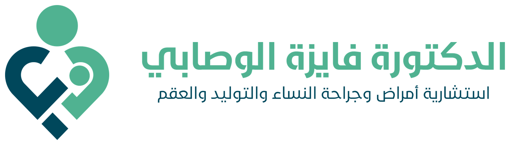
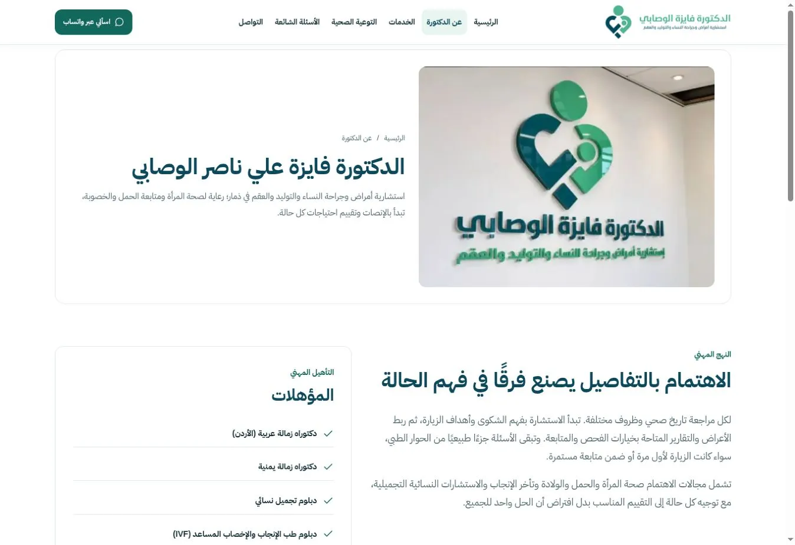
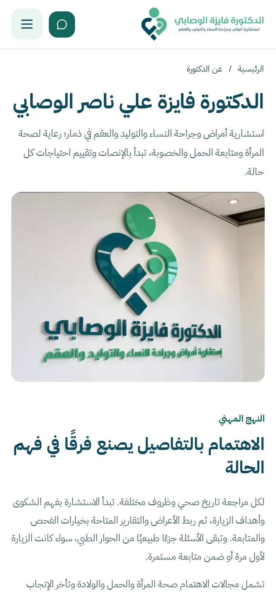

<div align="center">



# عيادة الدكتورة فايزة | Dr. Fayza Clinic

**موقع عيادة الدكتورة فايزة علي ناصر الوصابي في ذمار، للتعريف بخدمات النساء والتوليد والعقم، والتواصل والوصول إلى العيادة.**


**[🌐 زيارة الموقع](https://dr-fayza.vercel.app/)**

</div>

---

## 📱 Screenshots | صور المشروع

<div align="center">

<br /><br />

</div>

---

## ✨ Key Features | المميزات الرئيسية

- **التعريف بالدكتورة:** التخصص والمؤهلات ونهج رعاية صحة المرأة.
- **الخدمات الطبية:** ست صفحات تفصيلية للحمل وصحة المرأة والخصوبة والسونار والولادة والاستشارات التجميلية.
- **التوعية الصحية:** سبعة مقالات وإجابات للأسئلة الشائعة والتحضير للزيارة.
- **التواصل والوصول:** اتصال وواتساب وعنوان العيادة ومخطط الوصول وساعات العمل.
- **تجربة عربية:** تصميم RTL متجاوب، قائمة للهاتف وزر للعودة للأعلى.
- **تحميل خفيف:** صفحات ثابتة وصور متجاوبة وتحميل مؤجل وخطوط وأيقونات محلية.
- **البحث والمشاركة:** بيانات الصفحات والعيادة والخدمات، وخريطة الموقع وصور مشاركة الروابط.

---

## 🛠️ Tech Stack | التقنيات

| الجانب | التقنيات |
|---|---|
| **Frontend** | HTML، CSS، JavaScript |
| **Build** | Node.js، esbuild، Sharp، PurgeCSS |
| **Quality** | Playwright، Axe، Chromium، WebKit |
| **Deployment** | Vercel، GitHub Actions |

---

## 📂 Project Structure | هيكل المشروع

- `website/`: قوالب الصفحات ومحتواها والتنسيق والتفاعل والأصول.
- `docs/`: معلومات العيادة ودليل التطوير وصور الموقع.
- `brand/`: الشعار والهوية وملفاتها الأصلية.
- `tools/`: توليد أصول الهوية.
- `campaigns/` و`content/`: مواد الحملة والمحتوى الاجتماعي.

---

## 🚀 Getting Started | التشغيل المحلي

**المتطلبات:** Node.js 22 أو أحدث وnpm.

```bash
git clone https://github.com/7eaur/dr-fayza.git
cd dr-fayza
npm ci --prefix website
npm run build --prefix website
cd website
node scripts/audit-server.mjs
```

افتح `http://127.0.0.1:8000` في المتصفح. تفاصيل البنية والتحقق في [دليل التطوير](docs/DEVELOPMENT.md).

---

## 👨‍💻 Developer | المطور

**Eng. Elyas Al Shaebi — المهندس إلياس الشعيبي**

📱 **Phone / WhatsApp:** [+967 775 377 979](https://wa.me/967775377979)

[GitHub](https://github.com/7eaur)
